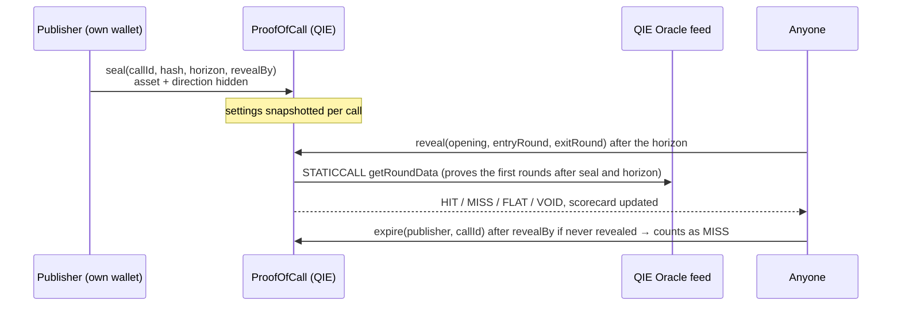

# RUNECLAW Proof of Call

**Tamper-proof track records for AI agents and signal publishers on QIE.** Every market call is sealed on chain as
a hash *before* its outcome is known. It is then revealed and scored by the contract against QIE Oracle prices.
Nobody can edit, drop or cherry-pick a call afterwards, including the publisher and the contract owner. A call that
is never revealed counts as a miss. If the oracle stalls, the call is VOID instead of getting a guessed price.

Built for QIE Mainnet Hackathon 3.0 by HUMANOID-TRADERS / RUNECLAW.

| Network | Status |
|---|---|
| QIE testnet (chain 1983) | **Live since 1 Nov 2026**: ProofOfCall [`0xb6567DB9…bfc29C54`](https://testnet.qie.digital/address/0xb6567DB95934ec74fabe4823D0c07125bfc29C54), record in `deployments/qie-testnet-1983.json` |
| QIE mainnet (chain 1990) | Deployed by the owner from his own wallet with the official QIE Oracle BTC / USDT and ETH / USDT feeds, verified read-only by the owner on 22 Nov 2026 (runbook `docs/MAINNET.md`). The address goes into `deployments/qie-mainnet-1990.json` |

## The problem

Trading bots, AI agents and signal sellers advertise their hit rates with screenshots, edited spreadsheets and
deleted posts. Losing calls disappear, winners get re-posted, and timestamps are whatever the seller says they are.
Buyers cannot check any of it.

## How it works



1. **Seal.** The publisher stores `keccak256(chainId, contract, publisher, callId, feed, direction, salt)`. The asset
   and the direction stay hidden; a random 32-byte salt stops anyone from guessing them.
2. **Reveal.** After the horizon (4 h or 12 h), anyone holding the opening reveals the call. The contract checks the
   opening against the hash. It then proves on chain that the entry price is the first oracle round after the seal
   and the exit price the first round after the horizon, so nobody can pick a convenient price.
3. **Score.** The result is HIT, MISS or FLAT (inside a small band). If the feed stalled for longer than the call's
   `maxGap` or gave bad data, the call is VOID: it fails closed and no price is guessed.
4. **No hiding.** After the reveal deadline anyone can expire an unrevealed call. It counts as a MISS.
5. **Public scorecards.** `scorecard(publisher)` is computed by the contract. The web app reads it, together with every
   call and its proof, straight from the chain.

Hard properties (`docs/DESIGN.md`):
- The contract accepts no value and holds no funds.
- It is not upgradeable and makes only `STATICCALL`s, to allowlisted feeds. A bytecode-walk test enforces this.
- The owner can manage the feed list and the defaults for *new* calls only. Nothing about an existing call can change.

## QIE integration

- **QIE blockchain**: the contract runs on QIE testnet and mainnet. We probed QIE's EVM level ourselves: Shanghai, with
  no Cancun opcodes (`docs/DEPLOY.md`). The build is pinned to `paris`, and the deploy scripts refuse any build that
  contains PUSH0 or Cancun opcodes.
- **QIE Oracle**: scoring uses the official QIE Oracle feeds through their Chainlink-style AggregatorV3 interface (BTC
  / USDT and ETH / USDT on mainnet). The round-proof design uses QIE's plain round ids. `script/FeedCadence.s.sol`
  measures each feed's update cadence to set `maxGap`. QIE testnet has no oracle contracts, so testnet uses our mock feed.
- **QIE wallets and infrastructure**: the web app connects the QIE Wallet extension, MetaMask and other injected
  wallets via EIP-6963, and adds the QIE network to the wallet when needed. It reads the public QIE RPCs and links every
  transaction to the QIE Blockscout explorers.

## Run it in 10 minutes (local chain, no wallet, no tokens)

Needs Node 22, Foundry and git.

```sh
git clone https://github.com/metafrogmeme-droid/proof-of-call.git && cd proof-of-call
git submodule update --init --recursive
forge build && forge test                      # 200+ contract tests: unit, fuzz, invariant, bytecode, deploy scripts
npm ci && npm run build && npm test            # CLI, read layer, web app incl. anvil and browser end-to-end tests
```

Then use three terminals:

```sh
# 1. a local QIE-like chain with the real contracts and two mock feeds
npm run chain:local

# 2. the web app (open http://127.0.0.1:5173/#/net/31337)
npm run dev:web

# 3. seal, push prices, wait, reveal (anvil's unlocked dev accounts sign; addresses are printed by step 1)
npm run -s poc -- seal --network local --signer unlocked --vault salts/demo.json --from <publisher> --asset BTC --direction up --horizon 4h
npm run -s poc -- mock-push --network local --signer unlocked --yes --from <admin> --asset BTC --price 65000
npm run chain:warp -- 4h
npm run -s poc -- mock-push --network local --signer unlocked --yes --from <admin> --asset BTC --price 66000
npm run -s poc -- reveal RC-0001 --network local --signer unlocked --vault salts/demo.json --from <publisher>
```

The web app now shows the call as a HIT. Its proof page re-checks the commitment and the oracle rounds in the browser.
To try the verifier flow, seal a second call and warp past its horizon. Then create a reveal link with
`poc share RC-0002 --network local --vault salts/demo.json --from <publisher> --base-url http://127.0.0.1:5173`, open
it, connect a wallet and click Reveal.

## Use it

- **Publishers**: `docs/CLI.md`. Seal from MetaMask, a Foundry keystore or a Ledger. Salts stay in an encrypted vault on
  your machine. Reveal after the horizon and share reveal links.
- **Everyone else**: the web app (`docs/WEB.md`). Scorecards, proof pages, and Reveal / Expire with any browser wallet.
  **Revealed calls are public:** once revealed, a call's asset, direction, prices and outcome are on chain for good.
- **Owner**: the mainnet deploy runbook for Windows PowerShell is `docs/MAINNET.md`; explorer verification is `VERIFY.md`.

## What was built during the hackathon

All code in this repository is new and was written for QIE Mainnet Hackathon 3.0. RUNECLAW's earlier HashKey Chain
entry served as a design reference only. No code from it is reused (`docs/DESIGN.md`, "Origin of the code").

| Phase | What | PR |
|---|---|---|
| Q1 | `ProofOfCall` contract: seal / reveal / expire, on-chain round and stall proofs, scorecards; mock feed; unit, fuzz, invariant and bytecode tests | [#1](https://github.com/metafrogmeme-droid/proof-of-call/pull/1) |
| Q2–Q3 | Testnet deploy tooling with chain and key guards, post-deploy check, QIE EVM-level probe; live testnet deployment | [#4](https://github.com/metafrogmeme-droid/proof-of-call/pull/4) |
| Q4 | Mainnet deploy tooling: PowerShell runbook, in-forge build guards, feed cadence probe, offline and fork dry runs | [#5](https://github.com/metafrogmeme-droid/proof-of-call/pull/5) |
| Q5 | Publisher CLI and shared TypeScript core: encrypted salt vault, browser-wallet / keystore / Ledger signing | [#6](https://github.com/metafrogmeme-droid/proof-of-call/pull/6) |
| Q6 | Read layer: calls, scorecards and verifiers straight from chain events, per-browser cache | [#7](https://github.com/metafrogmeme-droid/proof-of-call/pull/7) |
| Q7 | Static web app: scorecards, proof pages with in-browser verification, wallet connect, Reveal / Expire | [#8](https://github.com/metafrogmeme-droid/proof-of-call/pull/8) |
| Q8 | Docs pack: README, self-review (`docs/AUDIT.md`), explorer verification (`VERIFY.md`), local demo chain | [#9](https://github.com/metafrogmeme-droid/proof-of-call/pull/9) |
| Q9 | Presentation: demo-video script, talk notes, Q&A sheet, screenshots (`docs/presentation/`) | [#10](https://github.com/metafrogmeme-droid/proof-of-call/pull/10) |

## Traction plan

- **20+ sealed calls on mainnet.** RUNECLAW seals BTC and ETH calls at 4 h and 12 h horizons from its own wallet,
  starting right after the mainnet deployment (owner decision, 22 Nov 2026). Every call gets revealed inside its window,
  and anything left unrevealed can be expired by anyone as a miss. Wins and losses count alike.
- **5+ verifier wallets.** After each horizon, RUNECLAW shares the call's reveal link. Anyone can open it and reveal
  the call from their own wallet; the result is credited to RUNECLAW. Each such wallet, and each wallet that expires an
  overdue call, counts as a verifier.
- **Measured on chain, not claimed.** Sealed calls, revealed calls, hit rate and verifier wallets are all computed from
  chain data and shown live in the web app. Anyone can recount them from the events.

## Security and review

- `docs/THREAT_MODEL.md`: threats and mitigations per layer (contract, deploy tooling, CLI, read layer, web app), each
  tied to a test.
- `docs/AUDIT.md`: the self-review, covering method, findings and their status, known limitations and residual risks.
  **The code has not been audited externally.**
- CI on every PR covers `forge fmt` / build / test (ci profile), shellcheck, PSScriptAnalyzer + Pester (Windows
  PowerShell 5.1 and 7), Prettier, TypeScript, ESLint (strict type-checked), Vitest incl. anvil and Chrome
  end-to-end tests, and gitleaks over the full history.

## Repository layout

| Path | What |
|---|---|
| `src/ProofOfCall.sol` | The contract: seal / reveal / expire, round proofs, HIT / MISS / FLAT / VOID, scorecards |
| `src/interfaces/IAggregatorV3.sol` | Our own 5-function Chainlink-style feed interface (no external package) |
| `src/mocks/MockAggregatorV3.sol` | Testnet feed: 8 decimals, rounds pushed by its deployer (QIE testnet has no oracle) |
| `script/` | Testnet deploy (`deploy.sh`, `Deploy.s.sol`), mainnet deploy for the owner (`deploy-mainnet.ps1`), post-deploy check (`Check.s.sol`), feed cadence probe (`FeedCadence.s.sol`), shared guards |
| `test/` | Contract, deploy-script and Pester tests |
| `packages/core/` | TypeScript library shared by the CLI and the web app: ABI, networks, commitments, round proofs, openings, read layer |
| `packages/cli/` | Publisher CLI `poc` (`docs/CLI.md`) |
| `apps/web/` | Static web app (`docs/WEB.md`) |
| `deployments/` | Deployment records (testnet live; mainnet config, plus the record after the owner's deploy) |
| `scripts/` | ABI generator, local demo chain |
| `docs/` | `DESIGN.md`, `THREAT_MODEL.md`, `AUDIT.md`, `DEPLOY.md`, `MAINNET.md`, `CLI.md`, `READ_LAYER.md`, `WEB.md`, `presentation/` |
| `VERIFY.md` | Blockscout source verification commands (run only on the owner's decision) |

Licence: MIT (see `LICENSE`).
