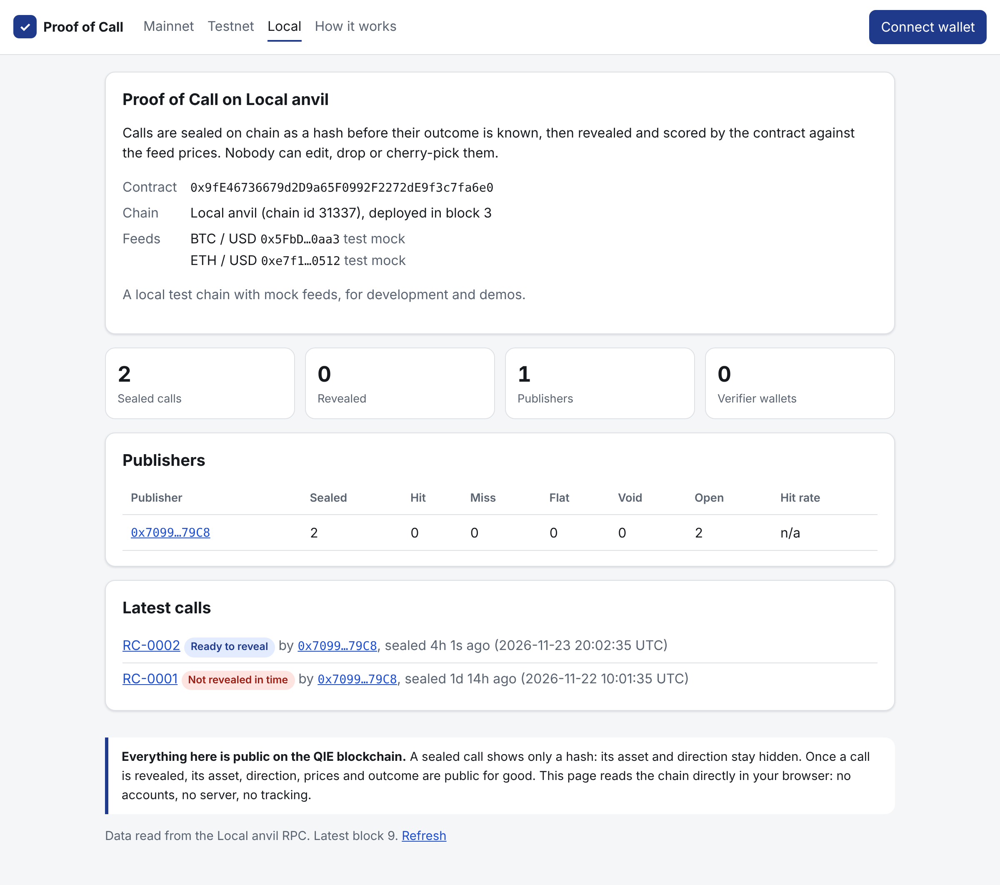
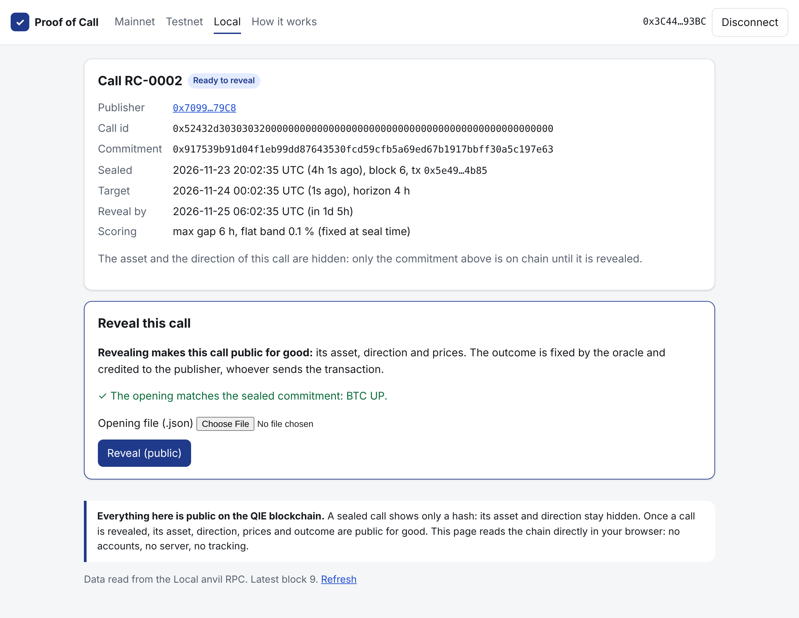
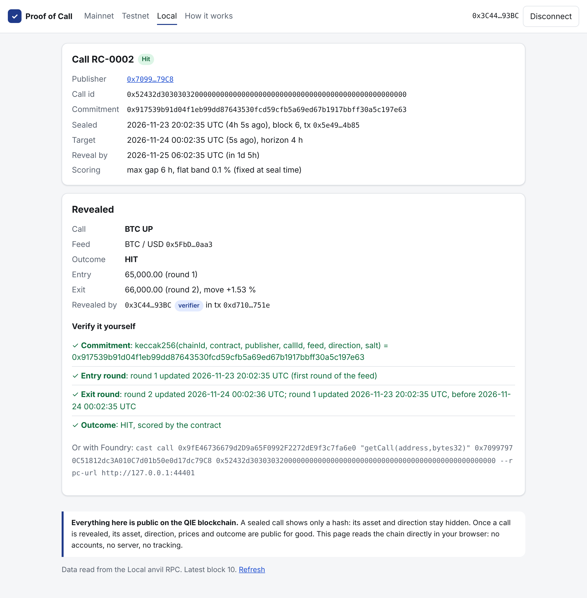
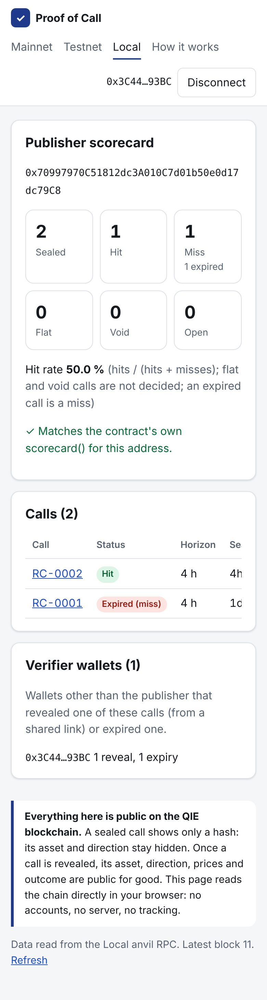

# Presentation material

| File | For |
|---|---|
| [`DEMO_SCRIPT.md`](DEMO_SCRIPT.md) | The ~4-minute demo video: checklist, shot list with timings, what to say |
| [`TALK_NOTES.md`](TALK_NOTES.md) | Explaining the architecture in plain words, with diagrams |
| [`QA.md`](QA.md) | Short answers to likely judge questions |

## Screenshots

Captured by the web app's end-to-end test (`POC_SCREENSHOTS=<dir> npm test`) on a **local demo chain** with mock
feeds. They show real app pages but not QIE data. Record the video on mainnet.

| | |
|---|---|
|  | **Network overview**: contract, feeds, sealed calls, publishers, latest calls |
|  | **Proof page, ready to reveal**: opened from a reveal link, the opening matches the commitment, the public warning |
|  | **Revealed call**: HIT with entry and exit prices, verifier badge, in-browser re-check of the commitment and the oracle rounds |
|  | **Publisher scorecard on a phone**: confirmed against the contract, verifier wallets |
