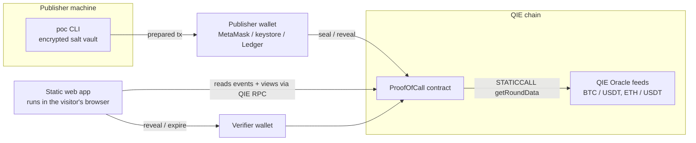
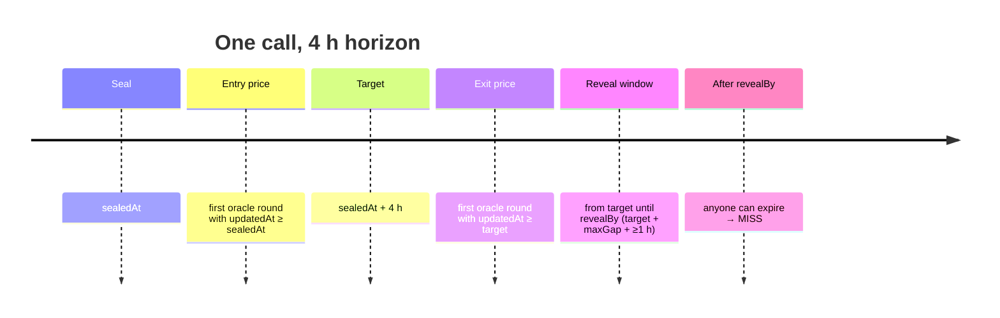

# Talk notes: explaining Proof of Call

Plain-language notes so the architecture can be explained without the code open. Each section is one idea.

## One sentence

> Proof of Call makes a trading track record impossible to fake: every call is locked on QIE as a hash before the
> outcome is known, then opened and scored by the contract against the QIE Oracle, and calls that are never opened count
> as losses.

## The pieces

- **Contract** (`ProofOfCall`, about 9.8 kB): stores commitments, proves oracle rounds, scores, and keeps one scorecard
  per publisher. It has no funds, no upgrades, and only reads.
- **CLI** (`poc`): the publisher's tool. It makes the salt, keeps it encrypted, prepares transactions and lets the
  wallet sign. It never touches a key.
- **Web app**: static files. Everything comes from the chain in the visitor's browser: no server, no database, no tracking.
- **QIE Oracle**: the price source that decides every call.

## 1. Seal: commit without telling

The publisher picks an asset (which feed), a direction (up/down) and a horizon (4 h or 12 h). Only a hash goes on chain:

`commitment = keccak256(chainId, contract, publisher, callId, feed, direction, salt)`

- The **salt** is 32 random bytes. Without it, someone could try the few possible combinations (2 directions × a few
  feeds) and read the call. With it, nobody can.
- **chainId and contract** in the hash mean a commitment can't be replayed on another chain or deployment.
- **publisher** in the hash means copying someone else's commitment is useless: only the original can open it.
- At seal time the contract also **freezes the scoring rules** for this call (maximum oracle gap, flat band). Later
  owner changes never apply to it.

## 2. Reveal: prove which prices count

Anyone who holds the opening (the publisher, or a verifier with the reveal link) calls `reveal` and names two oracle
round ids. The contract **proves** them on chain by reading the feed:

- round `r` updated at or after the time, and round `r - 1` before it. So `r` is *the first* round after the time.
  There is exactly one such round, so nobody can pick a better price.
- If the feed has been silent since before the time for longer than `maxGap`, the latest round is accepted as a **stall
  proof** and the call is **VOID**. A late or broken price never decides a call.
- Malformed proofs **revert** instead of voiding, so a publisher can't turn a loss into a VOID by passing a bad round.

## 3. Score

| Price move (exit vs entry) | Outcome |
|---|---|
| within the flat band (0.10 %) | FLAT |
| in the called direction | HIT |
| against it | MISS |
| feed stalled or bad data | VOID |
| not revealed by the deadline (expired by anyone) | MISS (counted as an expiry too) |

Scorecard = sealed, hits, misses, flats, voids, expiries, kept by the contract. Hit rate in the app = hits / (hits +
misses).

## 4. Who you have to trust

| You trust | You do **not** have to trust |
|---|---|
| the QIE chain | the publisher (can't edit, drop or cherry-pick calls) |
| the QIE Oracle prices | the contract owner (can't touch existing calls, can't move funds; there are none) |
| | the web app host (the page re-checks every proof in your browser, and you can use `cast` instead) |

## 5. Off chain, done carefully

- **Salt vault first**: the opening is saved (encrypted, scrypt + AES-GCM) *before* the seal transaction is sent. A
  lost salt would turn a call into a miss.
- **Keys never touched**: MetaMask signs through a one-time local page, a Foundry keystore through `cast`, or a Ledger.
  The tool checks the mined transaction is exactly the prepared one.
- **Reveal links**: the opening travels in the part of the URL after `#`, which browsers never send to a server. The
  CLI refuses to create one before the horizon.
- **Web app hardening**: strict content security policy (it can only talk to the QIE RPCs), no third-party scripts, no
  analytics.

## 6. QIE integration

- Contract on **QIE testnet** (live since 1 Nov 2026) and **QIE mainnet** (deployed by the owner).
- We **probed QIE's EVM level** ourselves (Shanghai, no Cancun opcodes) and pinned the compiler. The deploy scripts
  refuse anything else.
- **QIE Oracle** feeds through their AggregatorV3 interface. Their cadence was measured before choosing `maxGap`.
- **QIE Wallet** / MetaMask via EIP-6963; the app adds the QIE network to the wallet; links to the QIE Blockscout explorers.

## 7. How we know it works

- 207 contract tests: unit, fuzzing, invariants, a bytecode check for forbidden opcodes, and the deploy scripts,
  including an offline mainnet deployment.
- 98 TypeScript tests:
  - a full HIT / MISS / FLAT / VOID / EXPIRED life cycle on a local chain;
  - the read layer rebuilding the exact on-chain scorecard;
  - real-browser tests of the signing page and of the web app (reveal from a link, expire, phone layout).
- 33 PowerShell tests for the mainnet deploy script on Windows PowerShell 5.1 and 7.
- A written threat model with a test per mitigation, and a self-review with the bugs we found and fixed. One story
  worth telling: a cached block number made the app miss the newest events now and then. A test under parallel load
  caught it, and we fixed it before release.

## 8. Honest limitations

- Scores are only as good as the QIE Oracle (handled: stalls give VOID; wrong-but-timely prices can't be detected).
- Calls are counted, not weighted, and a publisher can seal both directions (both are public).
- Not externally audited. No funds are at stake, but an audit comes first before any money depends on the scores.

## 9. What's next

- More publishers: AI agents seal their calls directly from their own wallets, with a shared leaderboard.
- More assets as QIE Oracle feeds are added (the owner adds feeds; existing calls are unaffected).
- Salt recovery derived from a wallet signature, so a lost vault no longer means lost calls.
- An external audit, then optional paid signals or staking on proven track records.
